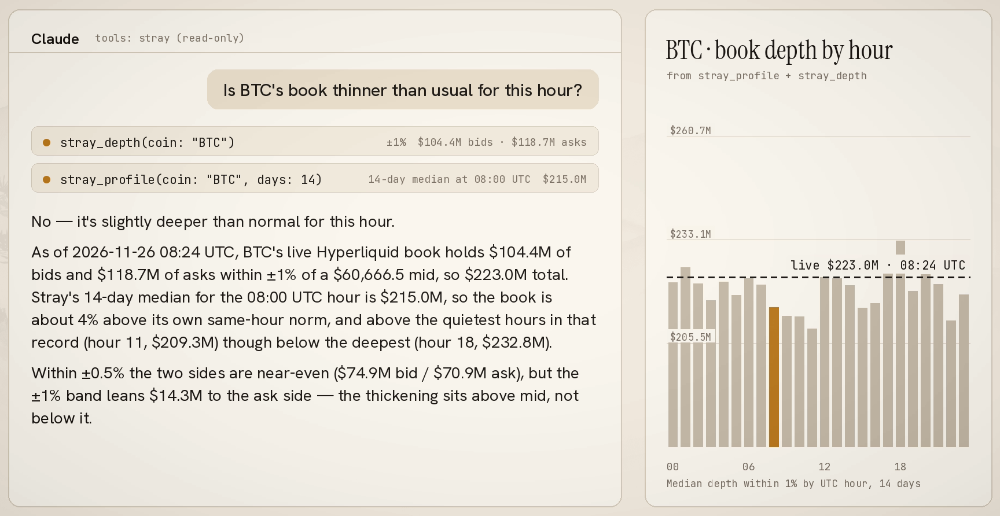

<p align="center">
  <a href="https://stray.fi/docs"></a>
</p>

<p align="center">
  <a href="https://www.npmjs.com/package/stray-mcp"></a>
  <a href="mcp/"></a>
  <a href="openapi.yaml"></a>
  <a href="LICENSE"></a>
  <a href="https://stray.fi/docs"></a>
  <a href="https://x.com/stray_fi"></a>
</p>

<p align="center">
  <a href="https://stray.fi"><b>stray.fi</b></a> ·
  <a href="https://stray.fi/docs"><b>API reference</b></a> ·
  <a href="https://stray.fi/docs/ai"><b>Use with AI</b></a> ·
  <a href="https://stray.fi/console"><b>Get a key</b></a> ·
  <a href="https://x.com/stray_fi"><b>@stray_fi</b></a>
</p>

# Stray cookbook

Code for building on the [Stray API](https://stray.fi/docs): a record of Hyperliquid perp markets (order-book depth,
funding, open interest, trade flow, whale positioning, liquidation levels and The Draw) with the same markets on
Binance, Bybit and OKX beside it.

| Folder | What's in it |
|---|---|
| [`mcp/`](mcp/) | An MCP server: the whole API as 23 read-only tools for Claude, Cursor or any MCP client |
| [`quickstart/`](quickstart/) | First calls in curl, Python and TypeScript, no dependencies |
| [`examples/`](examples/) | Four worked examples in Python (standard library only) |
| [`openapi.yaml`](openapi.yaml) | The API as an OpenAPI 3.1 spec, for codegen and API clients |

## Get a key

Sign in at [stray.fi/console](https://stray.fi/console) with an Ethereum wallet and make a key. Builder is
$29 a month for 100,000 calls (60 a minute); Pro is $149 for 2,000,000 calls (600 a minute) and the live stream.
**Until 31 December 2026, an account that hasn't had a plan can start 30 days of Builder free.**

```sh
export STRAY_API_KEY=stray_...
```

Every request sends it as a header (never in the URL):

```sh
curl https://stray.fi/v1/draw -H "Authorization: Bearer $STRAY_API_KEY"
```

## Use Stray with AI

<p align="center">
  
  <br><sub>A live run in Claude Code, 26 November 2026, 08:24 UTC. Watch the 56-second walkthrough on <a href="https://stray.fi/docs/ai">stray.fi/docs/ai</a>.</sub>
</p>

The MCP server gives a model the record as tools, so you can ask in plain words:

- "How crowded is the exit on HYPE if I'm holding $250k?"
- "Is BTC's move this week unusual?"
- "Are positions being opened or closed into this move?"
- "Where are the big liquidation levels on ETH, and how far from the mark?"
- "Is the funding gap between Hyperliquid and Binance real?"
- "What did BTC's book do between 13:00 and 15:00 UTC on 25 November?"

It's on npm as [`stray-mcp`](https://www.npmjs.com/package/stray-mcp) (Node 20 or later).

**Claude Code**

```sh
claude mcp add stray -e STRAY_API_KEY=stray_... -- npx -y stray-mcp
```

**Claude Desktop** (`~/Library/Application Support/Claude/claude_desktop_config.json` on macOS,
`%APPDATA%\Claude\claude_desktop_config.json` on Windows) and **Cursor** (`~/.cursor/mcp.json`):

```json
{
  "mcpServers": {
    "stray": {
      "command": "npx",
      "args": ["-y", "stray-mcp"],
      "env": { "STRAY_API_KEY": "stray_..." }
    }
  }
}
```

Most tool calls are one API call; the few that read several parts of the record say how many. The tools trim long series to the newest rows so replies stay small; the
[tool list](mcp/README.md) says what each returns. To run it from this repo instead:
`cd mcp && npm install`, then point the client at `node /absolute/path/to/stray-cookbook/mcp/index.js`.

## Quickstart

```sh
sh quickstart/curl.sh                 # needs jq
python3 quickstart/quickstart.py
node quickstart/quickstart.ts         # Node 22.18+, or: npx tsx quickstart/quickstart.ts
```

## Examples

```sh
cd examples
python3 01-is-the-book-thin.py BTC ETH HYPE        # depth now vs this hour's norm, and crowding
python3 02-funding-regime.py HYPE                  # funding on three venues, and what followed days like today
python3 03-size-against-depth.py BTC 5000000 buy   # how far from mid an order reaches, on four venues
python3 04-draw-watch.py                           # print when the market changes band
```

[`examples/stray.py`](examples/stray.py) is the small client they share: one `get()` that retries once on a 429 or
502, plus helpers for rows and timestamps.

## Good to know

- Times are UTC. Fractions are decimals: `-0.1379` is −13.79%. USD figures are US dollars.
- Errors are JSON, `{"error": "..."}`, written to be read by a person. 401 is a bad key, 402 no active plan,
  429 over a limit (wait `Retry-After` seconds).
- Every response carries `X-Quota-Remaining` and `X-RateLimit-Remaining`.
- Long series are paged by `from` and `to` (Unix milliseconds); each endpoint's span limit is in the
  [docs](https://stray.fi/docs).
- Stray describes the past and the present. Nothing in the API or this repo is a forecast or financial advice.

## License

MIT. See [LICENSE](LICENSE).
