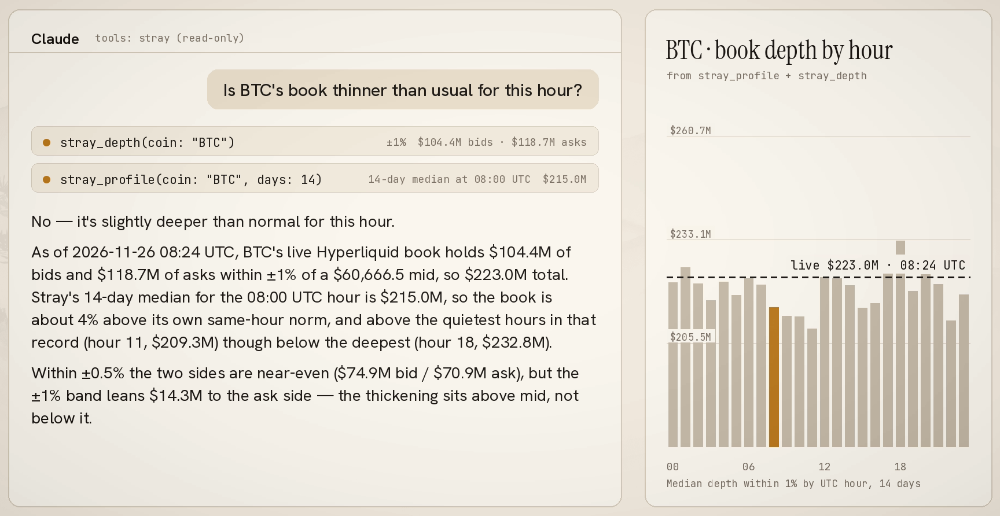

<p align="center">
  <a href="https://stray.fi/docs/ai"></a>
</p>

<p align="center">
  <a href="https://www.npmjs.com/package/stray-mcp"></a>
  <a href="#tools"></a>
  <a href="https://nodejs.org"></a>
  <a href="https://github.com/meex-works/stray-cookbook/blob/master/LICENSE"></a>
  <a href="https://stray.fi/docs/ai"></a>
  <a href="https://x.com/stray_fi"></a>
</p>

<p align="center">
  <a href="https://stray.fi/docs/ai"><b>Guide</b></a> ·
  <a href="https://stray.fi/docs"><b>API reference</b></a> ·
  <a href="https://stray.fi/console"><b>Get a key</b></a> ·
  <a href="https://github.com/meex-works/stray-cookbook"><b>Cookbook</b></a> ·
  <a href="https://x.com/stray_fi"><b>@stray_fi</b></a>
</p>

Stray records Hyperliquid's perp markets every minute: order-book depth, funding, open interest, trade flow, the
largest accounts' positions, liquidation levels and the Draw, with the same markets on Binance, Bybit and OKX beside
them. **stray-mcp** gives that record to Claude, Cursor or any MCP client as 23 read-only tools. Ask in plain words;
every answer comes back with its time, its source and what it was compared with.

<p align="center">
  
  <br><sub>A live run in Claude Code, 26 November 2026, 08:24 UTC. The 56-second walkthrough is on <a href="https://stray.fi/docs/ai">stray.fi/docs/ai</a>.</sub>
</p>

## Setup

Make a key at [stray.fi/console](https://stray.fi/console). Until 31 December 2026, an account that hasn't had a plan
can start 30 days of Builder free.

**Claude Code**

```sh
claude mcp add stray -e STRAY_API_KEY=stray_... -- npx -y stray-mcp
```

**Claude Desktop** (`~/Library/Application Support/Claude/claude_desktop_config.json` on macOS,
`%APPDATA%\Claude\claude_desktop_config.json` on Windows) and **Cursor** (`~/.cursor/mcp.json`):

```json
{
  "mcpServers": {
    "stray": {
      "command": "npx",
      "args": ["-y", "stray-mcp"],
      "env": { "STRAY_API_KEY": "stray_..." }
    }
  }
}
```

Node 20 or later. The server runs over stdio and talks only to `https://stray.fi/v1` (`STRAY_BASE_URL` overrides it).

## Ask it

| Ask | The agent reaches for |
|---|---|
| "How crowded is the exit on HYPE if I'm holding $250k?" | `stray_book_check` |
| "Is BTC's book thinner than usual for this hour?" | `stray_book_check`, then `stray_profile` |
| "Is BTC's move this week unusual?" | `stray_unusual` |
| "What's stretched right now?" | `stray_brief`, then `stray_draw` with a coin |
| "Are positions being opened or closed into this move?" | `stray_oi_change` |
| "Is the funding gap between Hyperliquid and Binance real?" | `stray_funding_venues` |
| "What did BTC's book do between 13:00 and 15:00 UTC on 25 November?" | `stray_history`, `stray_flow`, `stray_liquidity` with `end` |
| "Where are ETH's big liquidation levels?" | `stray_liqmap` |

## What comes back

Every result starts with `as_of` and `source`, then the comparison it was made against. Here is `stray_book_check`
for BTC with a $5M size, from a live run (trimmed):

```json
{
  "as_of": "2026-11-27T05:08:26.094Z",
  "source": "Hyperliquid live book; Stray's record",
  "coin": "BTC",
  "mid": 61647.5,
  "book": {
    "usd_within": {
      "0.5%": { "bids": 61928367, "asks": 64358816 },
      "1%": { "bids": 112535012, "asks": 116464746 }
    }
  },
  "usual_hour": { "hour_utc": 5, "median_usd_within_1pct": 218230588, "period_days": 14,
                  "vs_norm": 1.049 },
  "size": {
    "usd": 5000000,
    "sell": { "against": "bids", "covered_within": "0.5%", "share_of_band": 0.0807 },
    "buy": { "against": "asks", "covered_within": "0.5%", "share_of_band": 0.0777 },
    "caveat": "Resting orders at the book's as_of; they can be pulled or added to. Not a fill price."
  },
  "positions_per_book_dollar": { "value": 9.2, "percentile": 8, "period_days": 7 },
  "liquidations_within_5pct": {
    "below_0_2pct_usd": 0,
    "above_0_2pct_usd": 400612,
    "sample": "the top 1,500 Hyperliquid accounts by account value; not every position"
  },
  "api_calls": 4
}
```

Read: the book is 1.05× its usual depth for 05:00 UTC; $5M is 8% of the bids within 0.5%; positions per dollar of
book sit at the 8th percentile of the week; $400k of short liquidations sit within 2% above.

## Tools

**Composed: the comparison already made**

| Tool | Returns | API calls |
|---|---|---|
| `stray_book_check` | The live book against the usual depth for this UTC hour; with `usd`, the tightest band of resting orders that covers that size on each side; positions per dollar of book and its 7-day percentile; liquidation levels within 5% of the mark | 4 (2 for a HIP-3 market) |
| `stray_unusual` | Where the latest move sits among every past window of the same length, for up to three lengths (default 1, 7 and 30 days); implied against realized volatility for BTC and ETH | 1 per window, +1 for BTC/ETH |
| `stray_brief` | The whole market's Draw and its 24-hour change, all core markets ranked, and the components of the most tense | 1 + `top` (default 2) |
| `stray_oi_change` | Mark price and open interest (in coins, so price moves don't count as new positions) over 1 hour, 4 hours, 24 hours and 7 days | 1 |
| `stray_funding_venues` | Funding on Hyperliquid, Binance, Bybit and OKX on one hourly scale, each venue's gap to Hyperliquid and how many hours it has held its sign | 1 |

**One read each**

| Tool | Returns |
|---|---|
| `stray_draw` | The Draw, 0 (calm) to 100 (stressed): the whole market with each core market, or one market with its seven components and inputs |
| `stray_depth` | USD within ±0.5%, ±1% and ±2% of mid on the live book (core or HIP-3 markets) |
| `stray_profile` | The typical day: median depth, spread and volume for each UTC hour, plus the thinnest and deepest hours |
| `stray_crowding` | Open interest per dollar of book within ±1%, with the latest percentile |
| `stray_venues` | Hyperliquid, Binance, Bybit and OKX side by side, and Hyperliquid's share of depth |
| `stray_funding` | Funding on Hyperliquid, Binance or Bybit, ranked against all history, with who pays and the cost per $10,000 a day |
| `stray_conditional` | Today's funding decile and the spread of moves that followed past days in it, beside all days |
| `stray_ranges` | Percentiles of past moves over 1 to 90 days, and where the latest sits |
| `stray_flow` | Hyperliquid volume by aggressor side and the largest trade; Binance and Bybit liquidations by side; window totals |
| `stray_positioning` | Binance open interest, long/short accounts, top traders, taker volume |
| `stray_whales` | Totals of the top 1,500 Hyperliquid accounts' positions and HLP, with the long share's change over 1 h, 24 h and 7 d |
| `stray_liqmap` | Where those positions get liquidated, by distance from the mark, with the price at each band edge |
| `stray_implied` | Deribit implied volatility beside realized (BTC, ETH) |
| `stray_basis` | HYPE perp against spot, in basis points |
| `stray_correlation` | Correlation of daily returns between the core markets |
| `stray_liquidity` | Spread and USD in the top 5 and top 20 levels |
| `stray_history` | Stray's minute record: mark, oracle, funding, open interest, depth bands |
| `stray_markets` | The markets covered, and when recording began |

Series tools take `end` (ISO 8601 UTC) to read a past window, and `step` where rows can be thinned. Rows come back
named, newest last, at most 200.

## Prompts

Clients that show MCP prompts list six ready questions. Each names the tools to use and asks for the time and the
comparison behind every number.

| Prompt | Asks |
|---|---|
| `exit` | How crowded is the exit on a market (optionally for a size)? |
| `unusual` | Is the recent move unusual? |
| `pressure` | Which measured conditions are at unusual levels right now? |
| `thin` | Is the book thin for this hour, and when is it usually thinnest? |
| `venues` | How does Hyperliquid compare with Binance, Bybit and OKX right now? |
| `replay` | What did the book do between two times? |

## Good to know

- **Read-only.** The tools read the record and the live book. They can't place orders, sign anything or move funds.
- **A record, not a forecast.** Stray describes what markets have done. If an agent turns that into a price call,
  that part is the agent's.
- **The meter.** Most tool calls are one API call; the composed tools make up to four and report `api_calls`.
  Repeat reads of slow-moving data within 60 seconds are served from memory and cost nothing. Builder allows 60 calls
  a minute and 100,000 a month.
- **Units.** Times are UTC. Fractions are decimals (`-0.1379` is −13.79%). USD is US dollars. Funding is per hour on
  Hyperliquid and per 8 hours on Binance, Bybit and OKX; `stray_funding_venues` puts them on one scale.
- **Totals only.** Positions of the largest accounts are summed per market. No wallet appears anywhere.

## Development

```sh
git clone https://github.com/meex-works/stray-cookbook && cd stray-cookbook/mcp && npm install
npm test                                   # offline: a local fake API, no key, no quota
STRAY_API_KEY=stray_... npm run test:live  # starts the server, calls every tool once (about 30 calls)
```

The server is one file, [`index.js`](https://github.com/meex-works/stray-cookbook/blob/master/mcp/index.js). The live
stream (`/v1/stream`, Pro) isn't a tool: it's an open connection, not a question.

MIT © 2026 SHYGUY LLC
